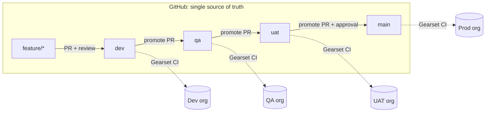
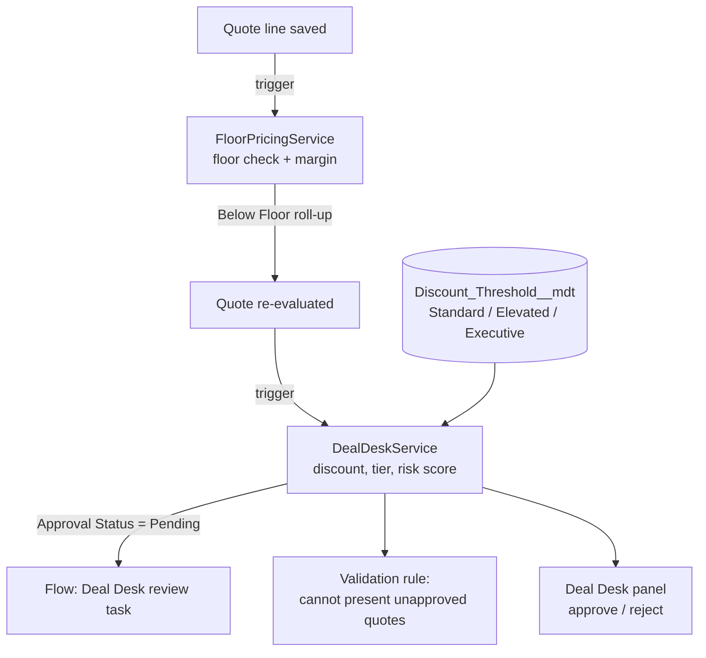

# Salesforce CPQ Release Pipeline with Gearset

Source-driven release management for a Salesforce CPQ org, delivered through **Gearset Pipelines** across four environments, with Git as the single source of truth.

The sample application is a **Deal Desk** for CPQ quotes. It is realistic enough to exercise every kind of change an enterprise CPQ team ships: custom fields, Apex triggers, a record-triggered flow, a Lightning Web Component, permission sets, custom metadata and **CPQ configuration data** (products, bundles, price rules, product rules, discount schedules).

---

## Release architecture



| Environment | Branch | Who merges | Gate before merge |
|---|---|---|---|
| Dev | `dev` | Developer | PR review, PMD, Jest, Gearset validation |
| QA | `qa` | Release manager | Gearset validation + Apex tests |
| UAT | `uat` | Release manager | Gearset validation + Apex tests, QA sign-off |
| Prod | `main` | Release owner only | Code owner approval, UAT sign-off, Gearset validation |

**Rules**

- Nobody deploys to QA, UAT or Prod by hand. Every change reaches an org through a pull request and a Gearset CI job.
- `main` always equals Production. Hotfixes branch from `main` and are back-propagated to `uat`, `qa` and `dev` so no environment drifts.
- Feature branches are named `feature/<ticket>-<short-description>`, for example `feature/DD-101-deal-desk-governance`.
- CPQ configuration (price rules, product rules, bundles) moves through the same pipeline as metadata, never re-keyed by hand in each org.

---

## Quality gates on every pull request

| Gate | Tool | Fails the PR when |
|---|---|---|
| Apex static analysis | PMD (`config/pmd/apex-ruleset.xml`) | Any security, error-prone, performance or complexity violation |
| LWC lint | ESLint with Salesforce LWC rules | Any lint error |
| Formatting | Prettier (Apex, JS, HTML, CSS) | Code is not formatted |
| LWC unit tests | Jest (`sfdx-lwc-jest`) | A test fails or coverage drops below threshold |
| Deployment validation | Gearset | The change would not deploy to the target org |
| Apex tests | Gearset (on validation) | Any Apex test fails |
| Human review | GitHub CODEOWNERS + branch protection | No approval from a code owner |

---

## The sample app: CPQ Deal Desk



| Component | Type | Purpose |
|---|---|---|
| `Deal_Risk_Score__c`, `Discount_Tier__c`, `Approval_Status__c` and 4 more | Custom fields on `SBQQ__Quote__c` | Governance outcome on every quote |
| `Floor_Price__c`, `Below_Floor__c`, `Line_Margin_Percent__c` | Custom fields on `SBQQ__QuoteLine__c` | Line-level price guardrails |
| `Floor_Price__c`, `Unit_Cost__c` | Custom fields on `Product2` | Floor and cost per product |
| `Discount_Threshold__mdt` + 3 records | Custom metadata | Tier thresholds as configuration, promoted like code |
| `DealDeskService`, `FloorPricingService` | Apex | Business rules, fully unit tested |
| `DealDeskQuoteTrigger`, `DealDeskQuoteLineTrigger` + handlers | Apex triggers | One thin trigger per object, with a bypass switch |
| `DealDeskController` | Apex | LWC controller, runs in user mode (FLS and sharing enforced) |
| `Deal_Desk_Review_Task` | Record-triggered flow | Creates a review task when approval is needed |
| `Block_Presenting_Unapproved_Quotes` | Validation rule | Stops unapproved risky quotes being presented |
| `dealDeskPanel` | LWC | Risk gauge, tier, floor breaches, approve/reject |
| `Deal_Desk_User`, `Deal_Desk_Approver` | Permission sets | Least-privilege access; approval needs a custom permission |

**CPQ configuration data** (seeded in Dev by `scripts/apex/seed-cpq-catalog.apex`, then promoted by Gearset):

- **Nimbus Cloud Platform** bundle with Licences and Services features and 4 options
- **Nimbus Seat Volume** range discount schedule (0% / 5% / 10%)
- **Free Onboarding on 3-Year Deals** price rule
- **Enterprise Agreement Required Above 5,000 Seats** product validation rule

---

## Getting started

Prerequisites: [Salesforce CLI](https://developer.salesforce.com/tools/salesforcecli), Git, Node.js 20+, VS Code with the Salesforce Extension Pack. On Windows, run the scripts in Git Bash.

```bash
npm install                                   # lint, format and test tooling
bash scripts/setup/connect-orgs.sh            # log in to dev, qa, uat, prod
bash scripts/setup/init-repo.sh <github-url>  # create main/uat/qa/dev + the feature branch
bash scripts/setup/deploy-to-dev.sh           # deploy to Dev only, run tests, seed CPQ data
```

Local checks before opening a PR:

```bash
npm run lint
npm run prettier:verify
npm run test:unit:coverage
```

---

## Project structure

```
.github/
  workflows/pr-quality-gate.yml   PMD + ESLint + Prettier + Jest on every PR
  pull_request_template.md        Change, testing, deployment and rollback checklist
  CODEOWNERS                      Mandatory reviewers
config/pmd/apex-ruleset.xml       Apex static analysis rules
force-app/main/default/           Salesforce metadata (source format)
scripts/apex/                     CPQ catalogue seed script
scripts/setup/                    Org login, repo initialisation, Dev deployment
```
